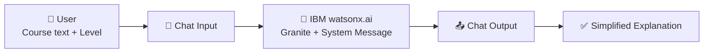
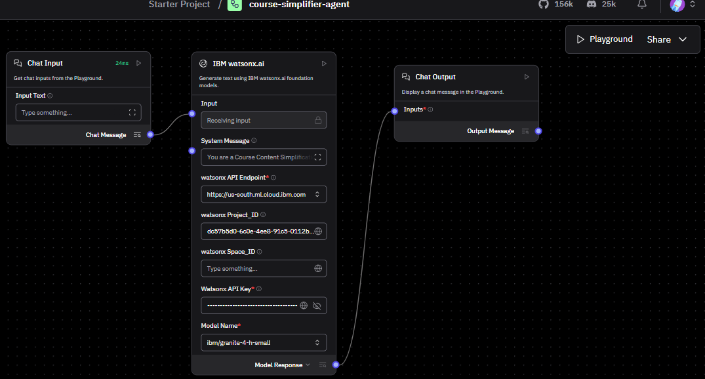
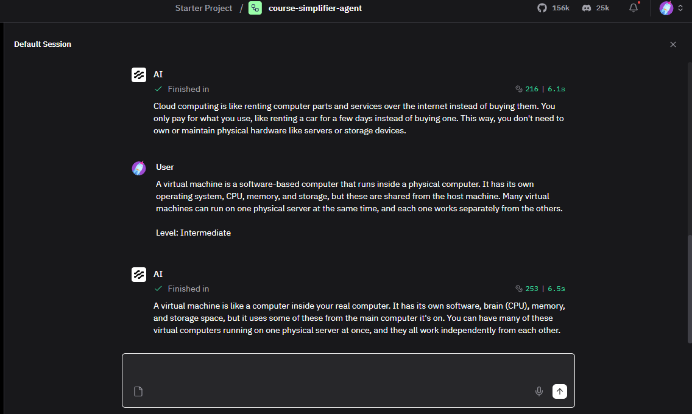
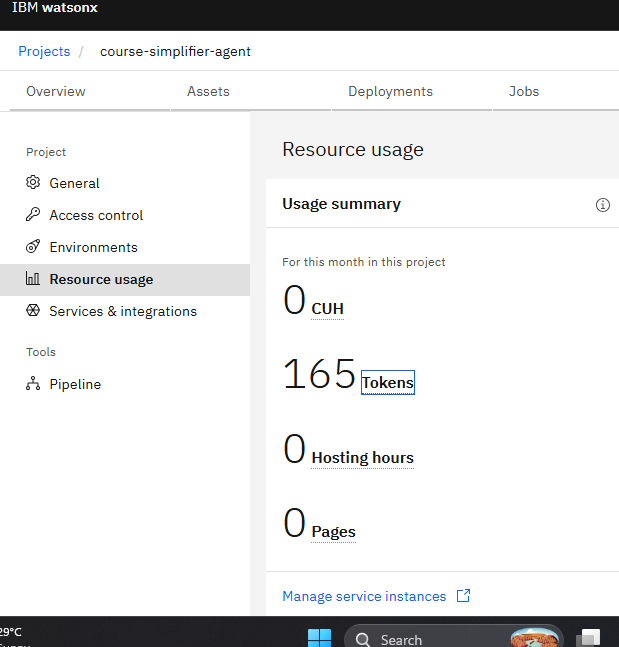
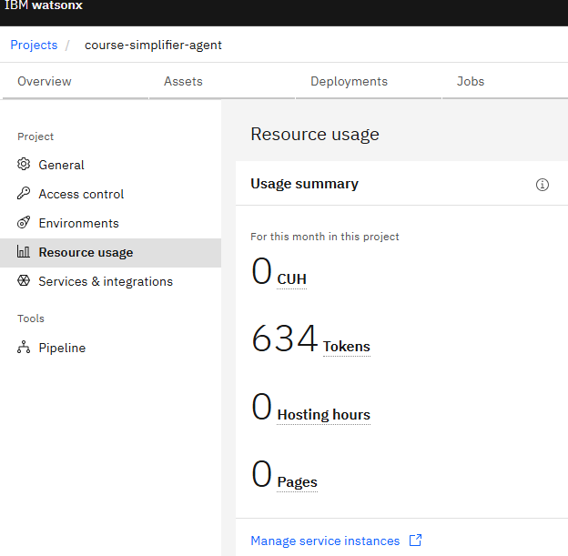

<div align="center">

# 📚 Course Content Simplification Agent

**An AI agent that explains any course content in simple language, at the level you choose.**


*Edunet Foundation × IBM SkillsBuild Virtual Internship (AICTE-2026)*

</div>

---

## 📑 Table of Contents

- [About the Project](#-about-the-project)
- [Features](#-features)
- [Tech Stack](#-tech-stack)
- [Architecture](#-architecture)
- [Langflow Workflow](#-langflow-workflow)
- [Demo](#-demo)
- [Token Usage](#-token-usage)
- [Setup Guide (Step by Step)](#-setup-guide-step-by-step)
- [Repository Structure](#-repository-structure)
- [Future Scope](#-future-scope)
- [Author](#-author)

---

## 📖 About the Project

Students often find course material hard to understand. This agent takes any course text and rewrites it in **simple language** based on the learner's level.

**How it works:**

1. The user pastes the course text.
2. The user writes a level below the text: **Beginner**, **Intermediate** or **Expert**.
3. **IBM Granite** (running on IBM watsonx.ai) explains the content at that level.

---

## ✨ Features

- 📝 Paste any course text and get a simplified explanation
- 🎚️ Three levels: Beginner, Intermediate, Expert
- 🤖 Powered by IBM Granite through IBM watsonx.ai
- 🔀 Visual low-code flow built in Langflow
- 🪶 Small, simple and easy to run

---

## 🧰 Tech Stack

| Component | Technology |
|-----------|------------|
| LLM | IBM Granite (`ibm/granite-4-h-small`) |
| AI Platform | IBM watsonx.ai (Dallas region) |
| Workflow Builder | Langflow Desktop (Windows) |
| Endpoint | `https://us-south.ml.cloud.ibm.com` |
| Version Control | GitHub |

---

## 🏗️ Architecture



---

## 🔀 Langflow Workflow

The flow has 3 components:

| # | Component | Purpose |
|---|-----------|---------|
| 1 | **Chat Input** | Takes the course text and level from the user |
| 2 | **IBM watsonx.ai** | Runs `ibm/granite-4-h-small` with a System Message |
| 3 | **Chat Output** | Shows the simplified explanation |



---

## 🎬 Demo

Tested in the Langflow Playground with two prompts.

**Prompt 1 (Beginner):**

```text
Cloud computing means delivering computing services such as servers, storage, databases, and networking over the internet, so users pay only for what they use instead of owning physical hardware.

Level: Beginner
```

**Prompt 2 (Intermediate):**

```text
A virtual machine is a software-based computer that runs inside a physical computer. It has its own operating system, CPU, memory, and storage, but these are shared from the host machine. Many virtual machines can run on one physical server at the same time, and each one works separately from the others.

Level: Intermediate
```



---

## 📊 Token Usage

Checked in watsonx.ai: **Project > Manage > Resource usage**

| Stage | Tokens Used |
|-------|-------------|
| Before the prompts | **165** |
| After 2 prompts (Beginner + Intermediate) | **634** |

<details>
<summary>📷 Click to view screenshots</summary>

**Before the Prompt**



**After the Prompt**



</details>

---

## 🚀 Setup Guide (Step by Step)

<details>
<summary><b>Step 1: Create the watsonx.ai project</b></summary>

1. Log in to [IBM Cloud](https://cloud.ibm.com) and open **watsonx.ai**.
2. Create a new project named `course-simplifier-agent` (region: Dallas).
3. Associate a **watsonx.ai Runtime** service with the project.
4. Copy the **Project ID** from the project's Manage tab.
5. Create an **IBM Cloud API key** and save it safely.

</details>

<details>
<summary><b>Step 2: Install Langflow Desktop</b></summary>

1. Download the Langflow Desktop installer for Windows.
2. Run the installer and finish the installation.
3. Open Langflow Desktop.

</details>

<details>
<summary><b>Step 3: Import the flow</b></summary>

1. Download `app.json` from this repository.
2. In Langflow, import the flow by uploading `app.json`.
3. Open the imported flow.

</details>

<details>
<summary><b>Step 4: Configure IBM watsonx.ai</b></summary>

1. Click the **IBM watsonx.ai** component.
2. Set the endpoint to `https://us-south.ml.cloud.ibm.com`.
3. Enter your own **Project ID** and **API key**.
4. Select the model `ibm/granite-4-h-small`.

</details>

<details>
<summary><b>Step 5: Run the agent</b></summary>

1. Click **Playground**.
2. Type your course text, then write the level on a new line below it:

```text
Cloud computing means delivering computing services such as servers, storage, databases, and networking over the internet, so users pay only for what they use instead of owning physical hardware.

Level: Beginner
```

3. Press Enter and read the simplified explanation.
4. Change the level to `Intermediate` or `Expert` to compare.

</details>

> 🔒 **Security note:** `app.json` does not contain any API key. Never upload your API key or Project ID to GitHub.

---

## 📁 Repository Structure

```text
course-simplifier-agent/
├── app.json                  # Exported Langflow flow
├── workflow.png              # Langflow workflow screenshot
├── playground-result.png     # Playground output
├── before-prompt-token.png   # Token usage before prompts
├── after-prompt.png          # Token usage after prompts
└── README.md
```

---

## 🔮 Future Scope

- Add a simple web interface for non-technical users
- Support PDF and document upload
- Support more languages (e.g. Hindi)
- Add quizzes and summaries after each explanation

---

## 👤 Author

**Nilesh Yadav**
BCA Student, Tilak Maharashtra Vidyapeeth, Pune

[](https://github.com/nileshyadav2803)

---

<div align="center">

⭐ If you like this project, give it a star!

</div>
