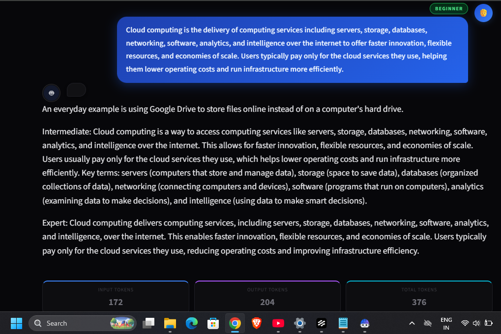
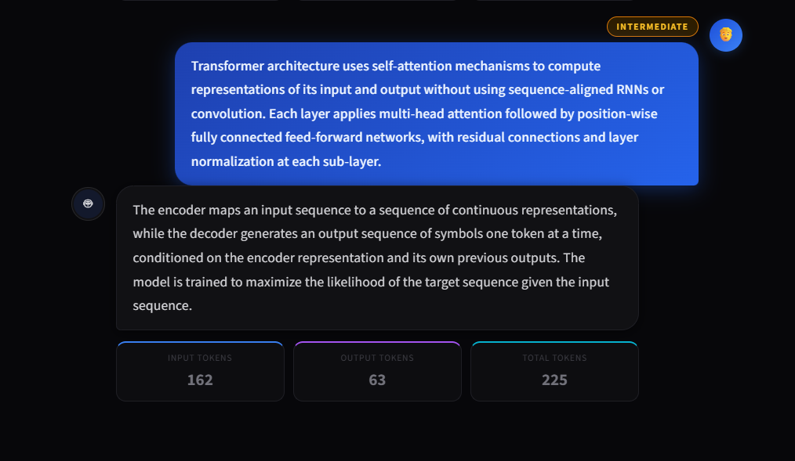
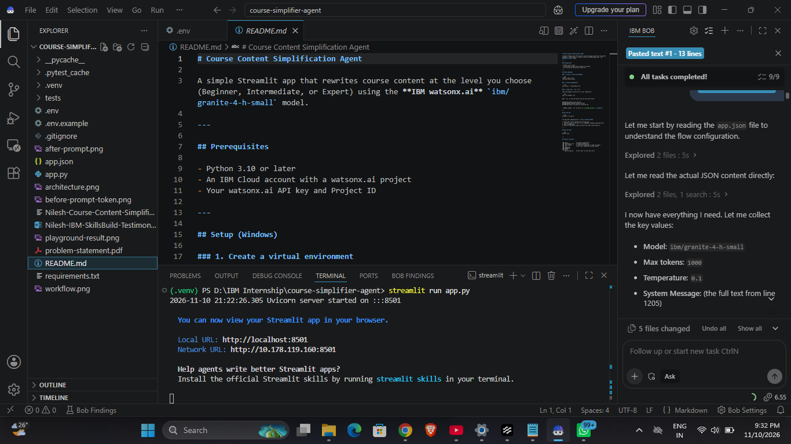
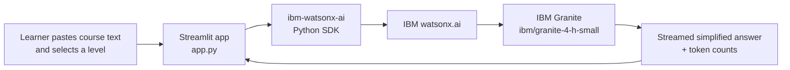
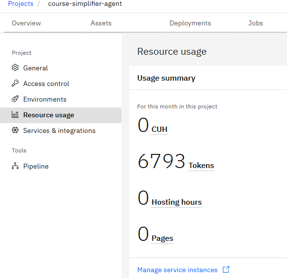

<div align="center">

# 📚 Course Content Simplification Agent

**An AI agent that rewrites academic content at the learner's level — Beginner, Intermediate or Expert — using IBM Granite on IBM watsonx.ai.**

[](https://www.python.org/)
[](https://streamlit.io/)
[](https://www.ibm.com/products/watsonx-ai)
[](https://www.ibm.com/)

*IBM University Engagement Project · Edunet Foundation × IBM SkillsBuild (AICTE 2026)*
*Problem Statement 19 — Exploring the Power of Agentic AI with IBM Granite*

</div>

---

## 📖 Overview

Study material is often too advanced, jargon-heavy or too basic for the person reading it. This app takes any course text and re-explains it **at the level the learner picks**, so the same content works for beginners, intermediate learners and experts.

The agent follows a fixed **System Message** (taken from the original Langflow flow in [`app.json`](app.json)) that defines it as a Course Content Simplification agent and tells it how to behave at each level.

---

## 🖼️ Screenshots

<table>
  <tr>
    <td align="center"><b>Beginner level</b></td>
    <td align="center"><b>Intermediate level</b></td>
  </tr>
  <tr>
    <td></td>
    <td></td>
  </tr>
</table>

<details>
<summary><b>🤖 How IBM Bob built the app (click to open)</b></summary>
<br>

</details>

---

## ✨ Features

| | Feature | Description |
|---|---|---|
| 🎚️ | **Level selector** | Pick Beginner, Intermediate or Expert with pill-style radio buttons |
| ⚡ | **Streaming output** | The answer appears word by word as the model writes it |
| 💬 | **Chat history** | Earlier questions and answers stay visible as chat bubbles |
| 📊 | **Token counter** | Input, output and total tokens shown after every response |
| 🔐 | **Safe credentials** | API key, Project ID and URL are read from a `.env` file, never hard-coded |
| 🧪 | **Unit tests** | 3 pytest tests that run without any real API call |

### Level guide

| Level | What the model does |
|---|---|
| 🟢 **Beginner** | Very simple words and short sentences, explains every term, adds a real-life example |
| 🟡 **Intermediate** | Clear language, keeps key technical terms with a short explanation |
| 🔴 **Expert** | Concise and precise, keeps all technical terms, removes extra explanation |

---

## 🏗️ Architecture



**Model settings** (same as the original Langflow flow in `app.json`):

| Setting | Value |
|---|---|
| Model | `ibm/granite-4-h-small` |
| Temperature | `0.1` |
| Max new tokens | `1000` |
| Endpoint | `https://us-south.ml.cloud.ibm.com` (Dallas) |

---

## 📊 Token Usage

Token usage of the watsonx.ai project `course-simplifier-agent`, measured before and after running the app.

| Before running the app | After running the app |
|---|---|
| 634 tokens | 6,793 tokens |

<table>
  <tr>
    <td></td>
    <td></td>
  </tr>
</table>

---

## 🚀 Quick Start (Windows)

**You need:** Python 3.10 or later, an IBM Cloud account, and a watsonx.ai project.

### 1. Clone the repository

```cmd
git clone https://github.com/nileshyadav2803/course-simplifier-agent.git
cd course-simplifier-agent
```

### 2. Create and activate a virtual environment

```cmd
python -m venv .venv
.venv\Scripts\activate
```

### 3. Install the dependencies

```cmd
pip install -r requirements.txt
```

### 4. Add your credentials

```cmd
copy .env.example .env
```

Open `.env` and fill in your values:

```env
WATSONX_API_KEY=your_ibm_cloud_api_key
WATSONX_PROJECT_ID=your_watsonx_project_id
WATSONX_URL=https://us-south.ml.cloud.ibm.com
```

> **Where to find them**
> - **API key:** [cloud.ibm.com](https://cloud.ibm.com) → Manage → Access (IAM) → API keys → Create
> - **Project ID:** [dataplatform.cloud.ibm.com](https://dataplatform.cloud.ibm.com) → your project → Manage → General

> ⚠️ **Never upload `.env` to GitHub.** It holds your secret key and is already listed in `.gitignore`.

### 5. Run the app

```cmd
streamlit run app.py
```

The app opens at **http://localhost:8501**.

---

## 🖥️ How to Use

1. Choose a level: **Beginner**, **Intermediate** or **Expert**.
2. Paste your course content into the text box.
3. Click **✦ Simplify**.
4. Read the simplified explanation and check the token cards below it.

---

## 🧪 Run the Tests

```cmd
pytest tests/ -v
```

None of the tests call the real API.

| Test | What it checks |
|---|---|
| `test_load_env_raises_on_missing_values` | Missing `.env` values give a clear error that names each missing variable |
| `test_system_message_is_loaded` | The System Message contains the level instructions from `app.json` |
| `test_build_prompt_prepends_level` | The prompt is built as `Level: <text>` for all 3 levels |

---

## 📁 Project Structure

```
course-simplifier-agent/
├── app.py                                  # Streamlit app + watsonx.ai API call
├── requirements.txt                        # Python dependencies
├── .env.example                            # Credential placeholders (safe to share)
├── .gitignore                              # Keeps .env, .venv and cache out of Git
├── app.json                                # Original Langflow flow (reference)
├── problem-statement.pdf                   # Problem Statement 19
├── tests/
│   └── test_app.py                         # 3 unit tests
├── Streamlit-app-beginner-mode.png         # Screenshots used in this README
├── Streamlit-app-intermediate-mode.png
├── bob-workflow.png
├── before-prompt-token-usage.png
├── after-prompt-token-usage.png
└── README.md
```

---

## 🛠️ Built With

| Tool | Role |
|---|---|
| [IBM Bob](https://www.ibm.com/) | AI coding assistant that generated and reviewed the app code |
| [IBM watsonx.ai](https://www.ibm.com/products/watsonx-ai) | Runs the Granite model |
| [IBM Granite](https://www.ibm.com/granite) (`ibm/granite-4-h-small`) | Writes the simplified explanations |
| [Streamlit](https://streamlit.io/) | Web interface |
| [ibm-watsonx-ai SDK](https://pypi.org/project/ibm-watsonx-ai/) | Python SDK to call watsonx.ai |
| [python-dotenv](https://pypi.org/project/python-dotenv/) | Reads credentials from `.env` |
| [Langflow](https://www.langflow.org/) | Original flow the app is based on (`app.json`) |

---

## 🔭 Future Scope

- 🌐 **Regional languages:** explain content in Hindi and Marathi
- 📄 **File upload:** upload notes or textbook pages directly
- ❓ **Practice questions:** generate short questions after each explanation

---

## 👤 Author

**Nilesh Indradev Yadav**
BCA graduate · Edunet Foundation × IBM SkillsBuild Intern (AICTE 2026)

---

<div align="center">

Made with **IBM Bob** · **IBM watsonx.ai** · **IBM Granite**

</div>
